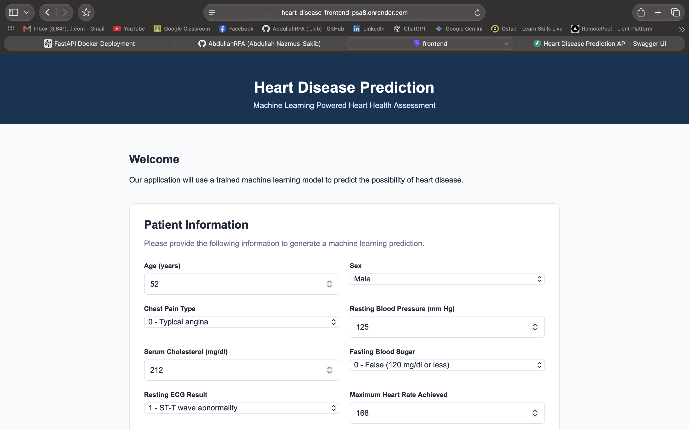
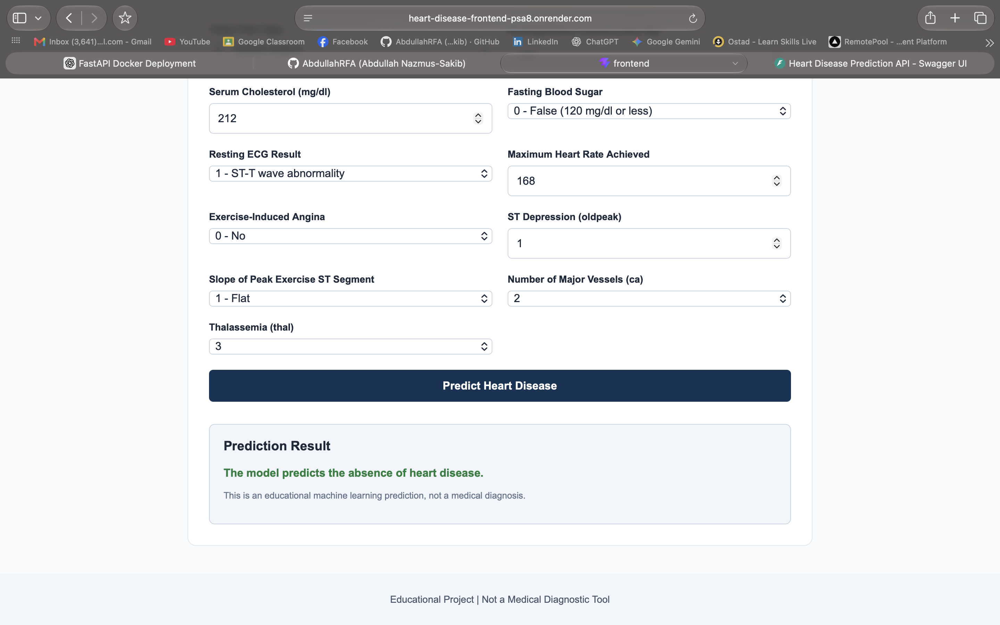
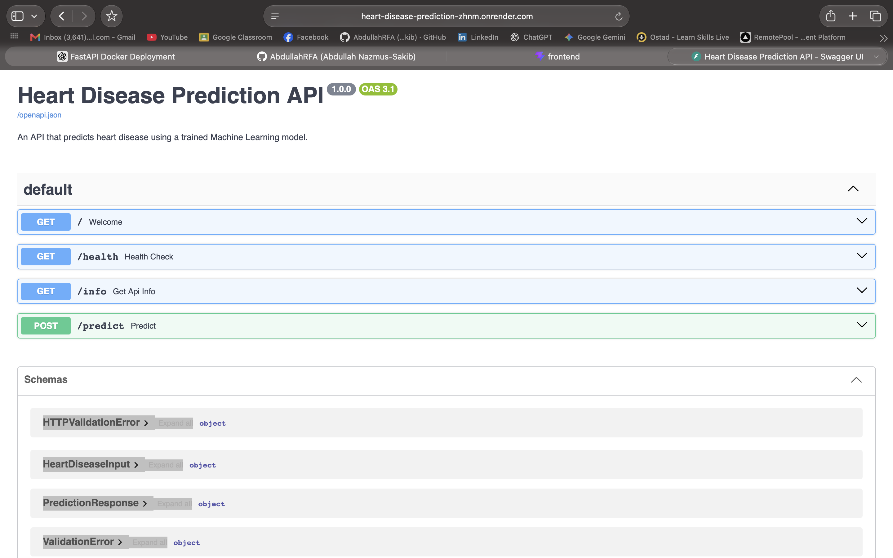
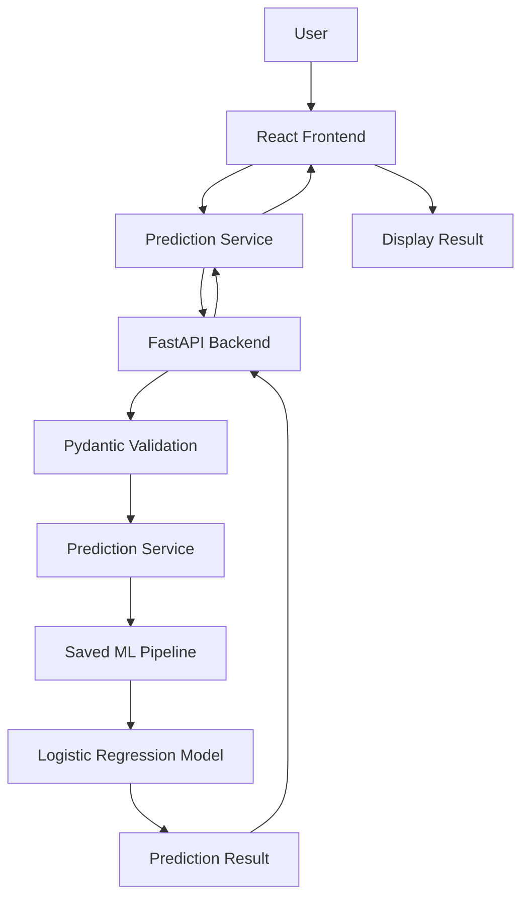

# Heart Disease Prediction System

A full-stack Machine Learning application that predicts the likelihood of heart disease based on 13 clinical features. The project combines a trained Logistic Regression model, a RESTful API built with FastAPI, and a React frontend. The application is containerized with Docker and deployed on Render.

<p align="center">
  <a href="https://heart-disease-frontend-psa8.onrender.com"><strong>Live Application</strong></a> ·
  <a href="https://heart-disease-prediction-zhnm.onrender.com/docs"><strong>API Documentation</strong></a>
</p>

---

## Table of Contents

- [Heart Disease Prediction System](#heart-disease-prediction-system)
  - [Table of Contents](#table-of-contents)
  - [Live Demo](#live-demo)
  - [Screenshot](#screenshot)
    - [Frontend](#frontend)
    - [Backend](#backend)
  - [Overview](#overview)
    - [Prediction Workflow](#prediction-workflow)
  - [Key Features](#key-features)
  - [System Architecture](#system-architecture)
    - [Application Components](#application-components)
    - [Deployment Architecture](#deployment-architecture)
  - [Machine Learning Pipeline](#machine-learning-pipeline)
    - [1. Data Preparation](#1-data-preparation)
    - [2. Feature Preprocessing](#2-feature-preprocessing)
    - [3. Model Training](#3-model-training)
    - [4. Model Serialization](#4-model-serialization)
  - [Technology Stack](#technology-stack)
  - [Dataset](#dataset)
    - [Input Features](#input-features)
  - [API Documentation](#api-documentation)
    - [Base URL](#base-url)
    - [1. Health Check](#1-health-check)
    - [2. API Information](#2-api-information)
    - [3. Heart Disease Prediction](#3-heart-disease-prediction)
    - [Interactive API Documentation](#interactive-api-documentation)
  - [Project Structure](#project-structure)
  - [Getting Started](#getting-started)
    - [Prerequisites](#prerequisites)
    - [1. Clone the Repository](#1-clone-the-repository)
    - [2. Backend Setup](#2-backend-setup)
    - [3. Frontend Setup](#3-frontend-setup)
  - [Docker Setup](#docker-setup)
    - [Build and Run with Docker Compose](#build-and-run-with-docker-compose)
  - [Deployment](#deployment)
    - [Frontend Deployment](#frontend-deployment)
    - [Backend Deployment](#backend-deployment)
    - [Deployment Environment Variables](#deployment-environment-variables)
  - [Model Performance](#model-performance)
    - [Selected Model: Logistic Regression](#selected-model-logistic-regression)
  - [Limitations and Disclaimer](#limitations-and-disclaimer)
  - [Future Improvements](#future-improvements)
  - [Author](#author)

---

## Live Demo

| Component | URL |
|---|---|
| Frontend Application | https://heart-disease-frontend-psa8.onrender.com |
| Backend API | https://heart-disease-prediction-zhnm.onrender.com |
| Interactive API Documentation | https://heart-disease-prediction-zhnm.onrender.com/docs |
| API Health Check | https://heart-disease-prediction-zhnm.onrender.com/health |

---
## Screenshot
### Frontend






### Backend

## Overview

The **Heart Disease Prediction System** is a full-stack Machine Learning project designed to demonstrate how a trained classification model can be integrated into a production-style web application.

Users can enter patient health information through an interactive React interface. The frontend sends the information to a FastAPI backend, which validates the input and passes it to a pre-trained Machine Learning pipeline. The API returns a binary prediction indicating whether the model predicts the presence of heart disease.

The application follows a modular architecture, separating the frontend, backend, and Machine Learning components. Docker is used to containerize the services, while Render is used for deployment.

### Prediction Workflow

1. The user enters 13 clinical attributes.
2. The React frontend collects and validates the form data.
3. The frontend sends a POST request to the FastAPI backend.
4. FastAPI validates the request using Pydantic schemas.
5. The trained preprocessing and classification pipeline processes the input.
6. The model generates a binary prediction.
7. The API returns the result as JSON.
8. The frontend displays the prediction to the user.

---

## Key Features

- **Machine Learning Prediction:** Predicts heart disease using a trained Logistic Regression classifier.
- **13 Clinical Features:** Accepts patient information through an interactive form.
- **RESTful API:** Provides prediction, health-check, and model information endpoints.
- **Input Validation:** Uses Pydantic to validate incoming API requests.
- **Reusable ML Pipeline:** Integrates preprocessing and classification into a single saved pipeline.
- **Responsive Frontend:** Built with React and Vite.
- **API Documentation:** Provides interactive Swagger UI through FastAPI.
- **Docker Support:** Uses separate Docker images for frontend and backend services.
- **Container Orchestration:** Includes Docker Compose configuration for local development.
- **Cloud Deployment:** Frontend and backend are deployed as separate Render services.

---

## System Architecture

The application follows a decoupled frontend-backend architecture.



### Application Components

| Component | Responsibility |
|---|---|
| React + Vite | User interface and form handling |
| Prediction Service | Handles HTTP requests to the backend |
| FastAPI | Exposes REST API endpoints |
| Pydantic | Validates incoming patient data |
| Scikit-learn Pipeline | Performs preprocessing and prediction |
| Joblib | Loads the saved ML model |
| Docker | Containerizes frontend and backend |
| Nginx | Serves the production frontend |
| Render | Hosts the deployed application |

### Deployment Architecture

The frontend and backend are deployed independently.

- **Frontend Service:** React application built with Vite and served using Nginx.
- **Backend Service:** FastAPI application served using Uvicorn.
- **Communication:** The frontend communicates with the backend through its deployed API URL.

---

## Machine Learning Pipeline

The project uses a supervised Machine Learning approach to solve a binary classification problem.

### 1. Data Preparation

The dataset is loaded and inspected using Pandas.

The preprocessing workflow includes:

- Inspecting the dataset structure.
- Checking missing values.
- Identifying and removing exact duplicate rows.
- Separating input features and target labels.
- Splitting the dataset into training and testing sets.

The dataset initially contains 1,025 records and 14 columns. After removing exact duplicate rows, 302 records remain.

### 2. Feature Preprocessing

Different preprocessing strategies are applied to numerical and categorical features.

**Numerical Features**

- age
- trestbps
- chol
- thalach
- oldpeak

StandardScaler is used to standardize numerical features.

**Categorical Features**

- sex
- cp
- fbs
- restecg
- exang
- slope
- ca
- thal

OneHotEncoder is used to convert categorical values into numerical representations. Unknown categories are handled using `handle_unknown="ignore"`.

A Scikit-learn ColumnTransformer combines both preprocessing strategies.

### 3. Model Training

Two classification algorithms were evaluated:

- Logistic Regression
- Random Forest Classifier

Both models were trained and evaluated using the same stratified train-test split.

The Logistic Regression model achieved better performance on the selected test split and was chosen for the final application.

### 4. Model Serialization

The preprocessing and classification steps are combined into a single Scikit-learn Pipeline.

The complete pipeline is saved using Joblib:

```python
joblib.dump(model_pipeline, "model/heart_model.joblib")
```

The backend loads this artifact and uses it to generate predictions without repeating the training process.

---

## Technology Stack

| Category | Technologies |
|---|---|
| Programming Languages | Python, JavaScript |
| Frontend | React, Vite, HTML, CSS |
| Backend | FastAPI, Uvicorn |
| Machine Learning | Scikit-learn |
| Data Processing | Pandas, NumPy |
| Data Preprocessing | StandardScaler, OneHotEncoder |
| Model Serialization | Joblib |
| API Validation | Pydantic |
| Web Server | Nginx |
| Containerization | Docker |
| Container Orchestration | Docker Compose |
| Deployment | Render |
| Version Control | Git, GitHub |

---

## Dataset

The project uses the Heart Disease dataset available on Kaggle.

**Dataset:** [Heart Disease Dataset – Kaggle](https://www.kaggle.com/datasets/johnsmith88/heart-disease-dataset)

### Input Features

The model accepts the following 13 features:

| Feature | Description |
|---|---|
| age | Age of the patient |
| sex | Sex (0 or 1) |
| cp | Chest pain type |
| trestbps | Resting blood pressure |
| chol | Serum cholesterol |
| fbs | Fasting blood sugar |
| restecg | Resting electrocardiographic result |
| thalach | Maximum heart rate achieved |
| exang | Exercise-induced angina |
| oldpeak | ST depression induced by exercise |
| slope | Slope of the peak exercise ST segment |
| ca | Number of major vessels |
| thal | Thalassemia category |

**Target Variable**

| Value | Meaning |
|---|---|
| 0 | Absence of heart disease |
| 1 | Presence of heart disease |

The API returns the predicted class as a Boolean value:

- `true` – The model predicts the presence of heart disease.
- `false` – The model predicts the absence of heart disease.

---

## API Documentation

The backend exposes three REST API endpoints.

### Base URL

```text
https://heart-disease-prediction-zhnm.onrender.com
```

### 1. Health Check

**Endpoint:** `GET /health`

Checks whether the backend API is running.

**Example Response**

```json
{
  "status": "healthy",
  "message": "Heart Disease Prediction API is running."
}
```

### 2. API Information

**Endpoint:** `GET /info`

Returns general information about the application and its Machine Learning model.

**Example Response**

```json
{
  "project": "Heart Disease Prediction",
  "model": "Logistic Regression",
  "framework": "FastAPI",
  "features": 13,
  "prediction_type": "Binary Classification"
}
```

### 3. Heart Disease Prediction

**Endpoint:** `POST /predict`

Accepts patient information and returns a prediction.

**Example Request**

```json
{
  "age": 52,
  "sex": 1,
  "cp": 0,
  "trestbps": 125,
  "chol": 212,
  "fbs": 0,
  "restecg": 1,
  "thalach": 168,
  "exang": 0,
  "oldpeak": 1.0,
  "slope": 2,
  "ca": 2,
  "thal": 3
}
```

**Example Response**

```json
{
  "heart_disease": false
}
```

### Interactive API Documentation

FastAPI automatically generates interactive API documentation.

Visit:

https://heart-disease-prediction-zhnm.onrender.com/docs

You can test all available endpoints directly through Swagger UI.

---

## Project Structure

```text
heart-disease-prediction/
│
├── frontend/
│   ├── public/
│   ├── src/
│   │   ├── components/
│   │   │   ├── Header.jsx
│   │   │   ├── Footer.jsx
│   │   │   ├── PatientForm.jsx
│   │   │   └── PredictionResult.jsx
│   │   │
│   │   ├── pages/
│   │   │   └── PredictionPage.jsx
│   │   │
│   │   ├── services/
│   │   │   └── predictionService.js
│   │   │
│   │   ├── App.jsx
│   │   ├── App.css
│   │   ├── index.css
│   │   └── main.jsx
│   │
│   ├── Dockerfile
│   ├── nginx.conf
│   ├── .dockerignore
│   └── package.json
│
├── backend/
│   ├── app/
│   │   ├── __init__.py
│   │   ├── main.py
│   │   ├── schemas.py
│   │   └── services/
│   │       ├── __init__.py
│   │       └── prediction.py
│   │
│   ├── model/
│   │   └── heart_model.joblib
│   │
│   ├── data/
│   ├── notebooks/
│   ├── Dockerfile
│   ├── requirements.txt
│   └── requirements-dev.txt
│
├── docker-compose.yml
├── .gitignore
└── README.md
```

---

## Getting Started

Follow these instructions to run the project locally.

### Prerequisites

Make sure the following tools are installed:

- Python 3.12
- Node.js and npm
- Git
- Docker Desktop or a compatible Docker Engine

### 1. Clone the Repository

```bash
git clone https://github.com/AbdullahRFA/heart-disease-prediction.git

cd heart-disease-prediction
```

### 2. Backend Setup

Navigate to the backend directory:

```bash
cd backend
```

Create a Python virtual environment:

```bash
python3 -m venv venv
```

Activate the environment on macOS or Linux:

```bash
source venv/bin/activate
```

Install the backend dependencies:

```bash
pip install -r requirements.txt
```

Ensure that the trained model artifact exists at:

```text
backend/model/heart_model.joblib
```

Start the FastAPI server from the `backend/` directory:

```bash
uvicorn app.main:app --reload
```

The backend will be available at:

```text
http://127.0.0.1:8000
```

API documentation:

```text
http://127.0.0.1:8000/docs
```

### 3. Frontend Setup

Open a new terminal and navigate to the frontend directory:

```bash
cd frontend
```

Install the dependencies:

```bash
npm install
```

Create a `.env` file in the `frontend/` directory:

```env
VITE_API_BASE_URL=http://127.0.0.1:8000
```

Start the Vite development server:

```bash
npm run dev
```

The frontend will be available at:

```text
http://localhost:5173
```

The frontend sends prediction requests directly to the local FastAPI backend.

---

## Docker Setup

The project includes separate Dockerfiles for the frontend and backend, along with a Docker Compose configuration.

### Build and Run with Docker Compose

From the project root directory:

```bash
docker compose up --build
```

To run the containers in detached mode:

```bash
docker compose up --build -d
```

Check running containers:

```bash
docker compose ps
```

View application logs:

```bash
docker compose logs -f
```

Stop the application:

```bash
docker compose down
```

**Note:** The frontend API URL is embedded during the Vite build. Make sure the Docker build configuration uses an API URL reachable from the user's browser, or configure the Nginx reverse proxy appropriately for your local Compose setup.

---

## Deployment

The application is deployed on [Render](https://render.com/) using two independent Docker Web Services.

### Frontend Deployment

- Built using the frontend Dockerfile.
- React application is compiled using Vite.
- Nginx serves the generated static assets.
- The API base URL is configured during the frontend build.

### Backend Deployment

- Built using the backend Dockerfile.
- FastAPI is served using Uvicorn.
- The application listens on `0.0.0.0` and uses the deployment platform's `PORT` environment variable when provided.
- The saved Machine Learning pipeline is loaded when the backend starts.

### Deployment Environment Variables

Configure the following variables in the Render dashboard:

**Backend**

```env
FRONTEND_URL=https://heart-disease-frontend-psa8.onrender.com
```

**Frontend Build Environment**

```env
VITE_API_BASE_URL=https://heart-disease-prediction-zhnm.onrender.com
```

Because Vite embeds environment variables into the production bundle during the build process, changing `VITE_API_BASE_URL` requires a new frontend build and deployment.

---

## Model Performance

The following results were obtained during model evaluation using an 80/20 stratified train-test split with `random_state=42`.

| Metric | Logistic Regression | Random Forest |
|---|---:|---:|
| Accuracy | 83.61% | 80.33% |
| Precision | 84.85% | 81.82% |
| Recall | 84.85% | 81.82% |
| F1-Score | 84.85% | 81.82% |

### Selected Model: Logistic Regression

Logistic Regression was selected because it achieved better results than Random Forest on the evaluated test split.

These metrics represent the experimental results from this particular dataset and split. They should not be interpreted as evidence of clinical accuracy or real-world diagnostic performance.

---

## Limitations and Disclaimer

This project is developed for **educational and demonstration purposes only**.

- The model is trained on a publicly available dataset and may not represent the broader population.
- Exact duplicate rows were removed during preprocessing. Since the dataset does not provide patient identifiers, duplicate records cannot necessarily be assumed to represent the same patient.
- The remaining dataset contains 302 records, and the test set contains 61 records.
- Model performance may vary with different datasets, populations, and validation strategies.
- The model has not been clinically validated.
- Predictions must not be used as a substitute for professional medical advice, diagnosis, or treatment.

**Always consult a qualified healthcare professional for medical decisions.**

---

## Future Improvements

Potential enhancements include:

- [ ] Add comprehensive unit and integration tests.
- [ ] Implement automated CI/CD using GitHub Actions.
- [ ] Add structured logging and monitoring.
- [ ] Improve API error handling and request validation.
- [ ] Add model explainability using SHAP.
- [ ] Evaluate additional classification algorithms.
- [ ] Perform cross-validation and hyperparameter tuning.
- [ ] Add model versioning and experiment tracking.
- [ ] Introduce authentication and rate limiting.
- [ ] Improve accessibility and frontend user experience.

---

## Author

**Abdullah Nazmus-Sakib**

Computer Science and Engineering Student | Machine Learning | Software Development

- GitHub: [AbdullahRFA](https://github.com/AbdullahRFA)
- Portfolio: [arkalim.netlify.app](https://arkalim.netlify.app)
- Live Project: [Heart Disease Prediction System](https://heart-disease-frontend-psa8.onrender.com)

---

<p align="center">
  If you find this project useful, consider giving it a ⭐ on GitHub.
</p>
